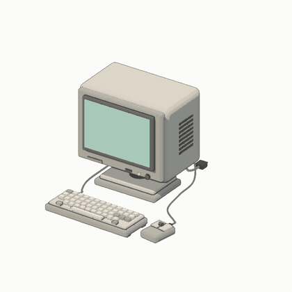
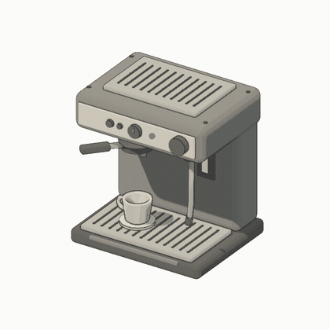
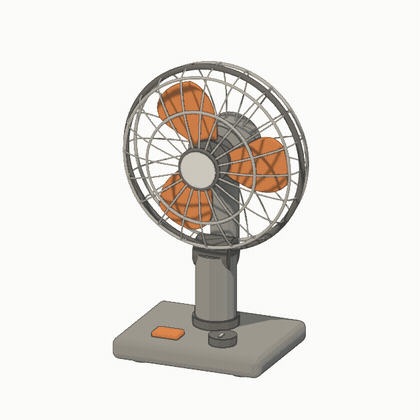

<h1 align="center">isom3trics</h1>

<p align="center"><strong>A skill and copy-in examples for building interactive Three.js figures of objects and mechanisms.</strong></p>

<p align="center">
<a href="media/animated/computer.mp4"></a>
<a href="media/animated/robotic-arm.mp4"></a>
<a href="media/animated/coffee-machine.mp4"></a>
<a href="media/animated/desk-fan.mp4"></a>
</p>
<p align="center"><sub><b>Computer</b> &nbsp;·&nbsp; <b>Robotic arm</b> &nbsp;·&nbsp; <b>Coffee machine</b> &nbsp;·&nbsp; <b>Desk fan</b></sub></p>

These four figures were built with the skill. Each tile loops through a full orbit. Click a tile for the square MP4.

[Use the skill](#use-the-skill) · [How it works](#how-it-works) · [Worked examples](#worked-examples) · [Verification](#verification)

## What it makes

Give a coding agent an object or mechanism to model. The skill guides it from the parts and their physical connections to a rotatable Three.js figure with hands-on controls. A vise handle turns and moves the jaw; a sewing machine handwheel drives the needle and feed. The same model state drives pointer input, keyboard input, and readouts.

Each figure ships as one standalone HTML file. Three.js loads from a CDN; the geometry, controls, and rendering code are inline. No build step is required.

## Use the skill

Give your coding agent this repository and ask it to read [`SKILL.md`](SKILL.md) before building. For example:

```text
Read SKILL.md and build an interactive miniature bench drill.
Use the closest worked example as a starting point. Let me turn the feed
handle and watch the spindle descend. Deliver one standalone HTML file.
```

## How it works

1. **Plan the mechanism.** Identify the fixed supports, moving parts, pivot axes, travel limits, and contacts that must stay seated.
2. **Build the figure.** Copy the closest worked example, replace its model factory, and keep the renderer and figure plate. The plate provides orbit, zoom, rotation lock, and optional palettes.
3. **Connect the controls.** Tie direct manipulation and native controls to the same state, with keyboard access and a repeatable reset.
4. **Test and repair.** Exercise the actual controls, check critical joints from multiple angles, and rerun failed checks after fixing them.

## What is in here

| Path | Purpose |
| --- | --- |
| [`SKILL.md`](SKILL.md) | The playbook: construction, interaction, and browser QA. Start here. |
| [`index.html`](index.html) and [`examples/`](examples/) | Twenty standalone worked examples to inspect and adapt. |
| [`media/`](media/) | README previews and downloadable MP4 loops. |

## Worked examples

1. [Personal computer](index.html) — Press the keyboard and slide the wired mouse.
2. [Bench vise](examples/bench-vise.html) — Turn the screw to close the jaws.
3. [Portable radio](examples/portable-radio.html) — Tune the dial and turn the volume knob.
4. [Stovetop espresso maker](examples/espresso-maker.html) — Lift the hinged lid.
5. [Robotic arm](examples/robotic-arm.html) — Swivel the base, bend the elbow, and close the gripper.
6. [Coffee machine](examples/coffee-machine.html) — Pull a shot and swing the steam wand.
7. [Dial indicator](examples/dial-indicator.html) — Inspect the probe and dial.
8. [Microscope](examples/microscope.html) — Operate the focusing assembly.
9. [Laboratory balance](examples/laboratory-balance.html) — Change the load and watch the reading.
10. [Rotary encoder](examples/rotary-encoder.html) — Inspect the shaft and rotary readout.
11. [Desk fan](examples/desk-fan.html) — Operate the fan.
12. [Cassette player](examples/cassette-player.html) — Operate the tape transport.
13. [Camera lens](examples/camera-lens.html) — Adjust the lens from its control ring.
14. [Turntable](examples/turntable.html) — Operate the record deck.
15. [Sewing machine](examples/sewing-machine.html) — Work the needle mechanism.
16. [Film projector](examples/film-projector.html) — Operate the reel mechanism.
17. [Hydraulic jack](examples/hydraulic-jack.html) — Raise and lower the saddle.
18. [Water valve](examples/water-valve.html) — Adjust the valve opening.
19. [Hand-crank drill](examples/hand-crank-drill.html) — Turn the crank.
20. [Drafting compass](examples/drafting-compass.html) — Adjust the span.

To run an example locally, serve the repository with `python3 -m http.server 8000` and open the corresponding HTML path. Three.js requires an internet connection.

## Verification

The skill calls for Playwright checks against the served page: exercise the real input path, verify part motion and reset, and inspect desktop and phone layouts. For moving assemblies, check attachment and clearance through the full range. Review screenshots from multiple angles and discard temporary QA images afterward.

## Credits

- [Diorama](https://github.com/sloemo01/diorama) is the parent project.
- [Anatomy](https://github.com/wheresryan22/anatomy) inspired the figure plates, controls, and colour palettes.
- Thanks to [GMI Cloud](https://www.gmicloud.ai/) for free credits. See [GMI Cloud’s console](https://console.gmicloud.ai/) for current offers.

## License

[MIT License](LICENSE).
