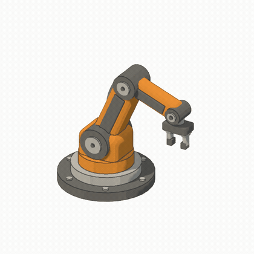

<h1 align="center">isom3trics</h1>

<p align="center"><strong>A skill for building interactive Three.js figures of objects and mechanisms.</strong></p>

<p align="center">
<a href="media/animated/computer.mp4"></a>
<a href="media/animated/robotic-arm.mp4"></a>
<a href="media/animated/coffee-machine.mp4"></a>
<a href="media/animated/desk-fan.mp4"></a>
</p>
<p align="center"><sub><b>Computer</b> &nbsp;·&nbsp; <b>Robotic arm</b> &nbsp;·&nbsp; <b>Coffee machine</b> &nbsp;·&nbsp; <b>Desk fan</b> &nbsp;·&nbsp; click a tile for the MP4</sub></p>

<p align="center"><b><a href="#install">Install</a></b> &nbsp;·&nbsp; <b><a href="#update">Update</a></b> &nbsp;·&nbsp; <a href="#figures">Figures</a> &nbsp;·&nbsp; <a href="#credits">Credits</a></p>

Give a coding agent an object or mechanism to model. The skill covers the parts, their physical connections, the controls, and the checks. A vise handle turns and moves the jaw; a sewing machine handwheel drives the needle and feed. Each figure ships as one standalone HTML file with no build step.

## Install

```
Install the isom3trics skill, then use it to build figures.

1. Ask where the folder should go before installing. Propose ./skills/isom3trics.
2. Install from the registry only, never a clone:
     npx --yes isom3trics@latest "<target>"
3. Prove it before describing it: --version, then
     find "<target>" -type f | wc -l     # expect 45
   If the count differs, stop and say so.
4. Read SKILL.md and the closest worked example. Then ask me what to build.
```

The command on its own is `npx --yes isom3trics@latest ./skills/isom3trics`. It writes the skill, twenty examples, the gallery and the previews, and adds nothing to install. `--list` previews the copy; `--force` overwrites.

## Update

```
Update my isom3trics install, then report what changed.

1. Ask for the folder, back it up, then refresh in place:
     npx --yes isom3trics@latest "<target>" --force
2. Prove the version and file count, then report the version jump, new or
   removed examples, and rules that changed in SKILL.md.
```

## Figures

[Personal computer](index.html) · [Bench vise](examples/bench-vise.html) · [Portable radio](examples/portable-radio.html) · [Stovetop espresso maker](examples/espresso-maker.html) · [Robotic arm](examples/robotic-arm.html) · [Coffee machine](examples/coffee-machine.html) · [Dial indicator](examples/dial-indicator.html) · [Microscope](examples/microscope.html) · [Laboratory balance](examples/laboratory-balance.html) · [Rotary encoder](examples/rotary-encoder.html) · [Desk fan](examples/desk-fan.html) · [Cassette player](examples/cassette-player.html) · [Camera lens](examples/camera-lens.html) · [Turntable](examples/turntable.html) · [Sewing machine](examples/sewing-machine.html) · [Film projector](examples/film-projector.html) · [Hydraulic jack](examples/hydraulic-jack.html) · [Water valve](examples/water-valve.html) · [Hand-crank drill](examples/hand-crank-drill.html) · [Drafting compass](examples/drafting-compass.html)

Serve the repo with `python3 -m http.server 8000` and open a page; Three.js needs a connection.

## Credits

[Diorama](https://github.com/sloemo01/diorama) is the parent project. [Anatomy](https://github.com/wheresryan22/anatomy) inspired the figure plates, controls and palettes. Thanks to [GMI Cloud](https://www.gmicloud.ai/) for free credits.

## License

[MIT License](LICENSE).
