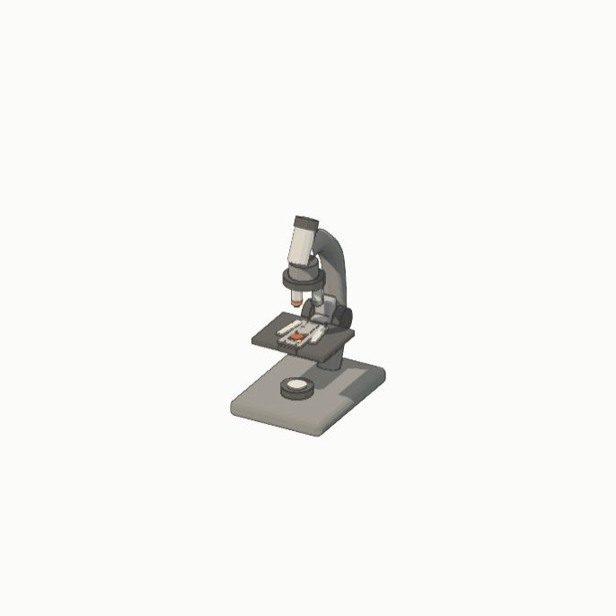
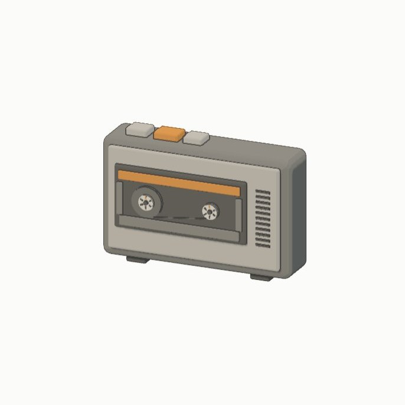
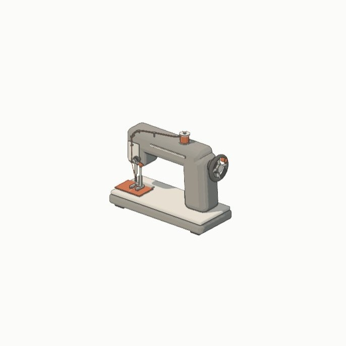
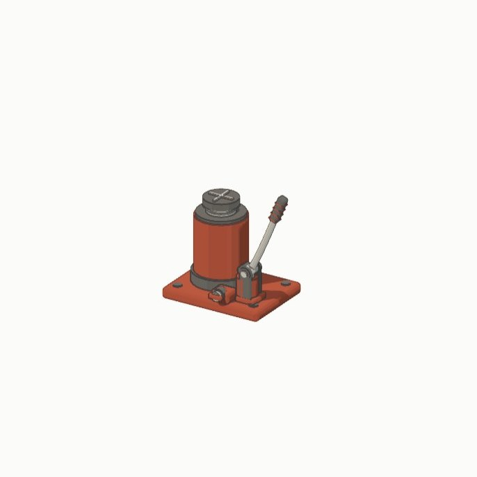

<h1 align="center">isom3trics</h1>

<strong>Twenty interactive Three.js miniatures. Turn a dial, work a lever, or orbit the model.</strong>

<b>Microscope</b> &nbsp;·&nbsp; <b>Cassette player</b> &nbsp;·&nbsp; <b>Sewing machine</b> &nbsp;·&nbsp; <b>Hydraulic jack</b>

Four fixed-angle previews. The examples below are interactive. Each is a standalone HTML page; Three.js loads from a CDN, with no build step.

## Credits

- [Diorama](https://github.com/sloemo01/diorama) is the parent project.
- [Anatomy](https://github.com/wheresryan22/anatomy) inspired the figure plates, controls, and colour palettes.
- Thanks to [GMI Cloud](https://www.gmicloud.ai/) for free credits. See [GMI Cloud’s console](https://console.gmicloud.ai/) for current offers.

## Examples

Browse the [gallery](gallery.html), or open a figure directly:

1. [Personal computer](index.html) — Press the keyboard and slide the wired mouse.
2. [Bench vise](examples/bench-vise.html) — Turn the screw to close the jaws.
3. [Portable radio](examples/portable-radio.html) — Tune the dial and turn the volume knob.
4. [Stovetop espresso maker](examples/espresso-maker.html) — Lift the hinged lid.
5. [Robotic arm](examples/robotic-arm.html) — Swivel the base, bend the elbow, and close the gripper.
6. [Coffee machine](examples/coffee-machine.html) — Pull a shot and swing the steam wand.
7. [Dial indicator](examples/dial-indicator.html) — Inspect the probe and dial.
8. [Microscope](examples/microscope.html) — Operate the focusing assembly.
9. [Laboratory balance](examples/laboratory-balance.html) — Change the load and watch the reading.
10. [Rotary encoder](examples/rotary-encoder.html) — Inspect the shaft and rotary readout.
11. [Desk fan](examples/desk-fan.html) — Operate the fan.
12. [Cassette player](examples/cassette-player.html) — Operate the tape transport.
13. [Camera lens](examples/camera-lens.html) — Adjust the lens from its control ring.
14. [Turntable](examples/turntable.html) — Operate the record deck.
15. [Sewing machine](examples/sewing-machine.html) — Work the needle mechanism.
16. [Film projector](examples/film-projector.html) — Operate the reel mechanism.
17. [Hydraulic jack](examples/hydraulic-jack.html) — Raise and lower the saddle.
18. [Water valve](examples/water-valve.html) — Adjust the valve opening.
19. [Hand-crank drill](examples/hand-crank-drill.html) — Turn the crank.
20. [Drafting compass](examples/drafting-compass.html) — Adjust the span.

Run `python3 -m http.server 8000` from this directory and open `http://localhost:8000/gallery.html`. Each page has an [Anatomy](https://github.com/wheresryan22/anatomy)-inspired figure plate with a full-width 3D stage, footer readout, and controls below the caption. The sliders and buttons control the same model as direct manipulation. Use the padlock at the bottom right of the plate to freeze rotation while you interact with parts. Zoom still works, and R resets the view without unlocking it. Drag to orbit, scroll to zoom, or focus the canvas and use the arrow keys to rotate and **R** to reset. Three.js requires an internet connection.

Drag a working part to move it, or drag empty space to orbit. On desktop, a grab cursor marks draggable parts.

- Computer: press any key or mouse button; drag the mouse shell to slide it. Click the screen to toggle power.
- Vise: drag an end of the cross handle in a circle to spin it and shift the jaw.
- Radio: drag either knob sideways to turn it; the large knob moves the tuning needle.
- Stovetop pot: drag the lid upward or tap it to open it.
- Robot: drag the upper arm sideways to swivel the base, or the forearm vertically to bend the elbow. Tap the forearm to jog it and the gripper to open or close it.
- Coffee machine: press the left button to brew, hold the next button for steam, and drag the steam wand sideways to swing it.

With the canvas focused, **Enter/Space** activates the default or selected action. **[ / ]** select a control, **− / +** adjust it, and **R** resets the model and camera.

## Use the skill

Read [`SKILL.md`](SKILL.md), then copy the closest example and replace its model factory. Keep the standalone renderer and figure plate.

MIT licensed; see [`LICENSE`](LICENSE).
